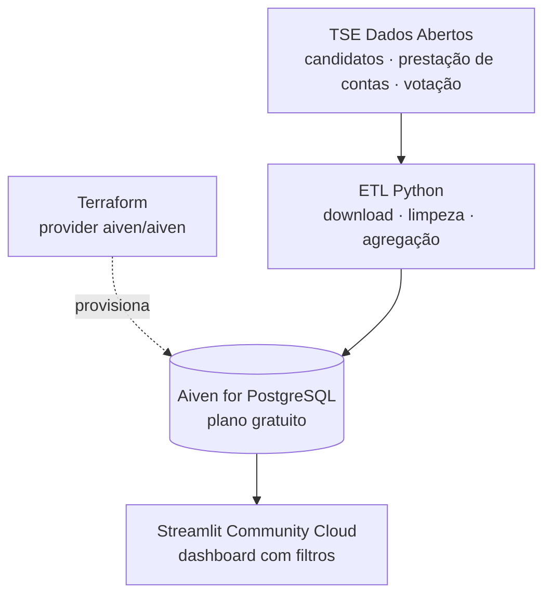

# Representatividade Política e Financiamento Eleitoral (ODS 5 e ODS 18)

Pipeline de engenharia e análise de dados em nuvem a custo zero: **TSE (dados abertos) → ETL Python → Aiven for PostgreSQL (Free) → Streamlit Community Cloud**.

Dashboard online
https://tabsheila-dlt3mxv9roruzkv3mtvwgr.streamlit.app/

Informações do trabalho
	
Disciplina	Computação em Nuvem/Engenharia de software 
Tema 7	Representatividade Política e Financiamento Eleitoral
Integrantes: Pedro Henrique de Carvalho Pereira, Eduardo Costa, Mateus da Cruz, Breno Dias e Felipe Ferreira 

**Pergunta:** como os recursos de campanha (FEFC, fundo partidário, doações) se distribuem entre candidaturas por **gênero × raça/cor**, e isso se reflete em votos e eleitos?

## Arquitetura



Só o PostgreSQL é usado: no plano gratuito atual da Aiven há PostgreSQL, MySQL e Valkey. Kafka e OpenSearch ficam fora do plano gratuito (só no teste de 30 dias), e este projeto não precisa deles.

## Estrutura

```
terraform/   main.tf, variables.tf, outputs.tf, terraform.tfvars.example
sql/         schema.sql (tabelas, índices e view analítica)
src/ods/     config, classify (regras), transform (pandas), pipeline, db, metrics, data
etl/         run_etl.py (CLI)
app/         streamlit_app.py
tests/       dados sintéticos no layout do TSE + teste ponta a ponta
```

## Manual de execução

```bash
# 0. Ambiente
python -m venv .venv && source .venv/bin/activate
pip install -r requirements.txt

# 1. Infraestrutura (token NUNCA em arquivo)
export TF_VAR_aiven_api_token="SEU_TOKEN"
cd terraform && cp terraform.tfvars.example terraform.tfvars   # edite aiven_project
terraform init && terraform apply
export DATABASE_URL="$(terraform output -raw postgres_uri)"
cd ..

# 2. ETL (filtre cargos/UFs para caber em 1 GB)
python etl/run_etl.py --anos 2022 --download \
    --cargos "DEPUTADO FEDERAL" "DEPUTADO ESTADUAL" "SENADOR" "GOVERNADOR"

# 3. Dashboard local
streamlit run app/streamlit_app.py
```

**Deploy:** publique o repositório no Streamlit Community Cloud (arquivo principal `app/streamlit_app.py`) e coloque `DATABASE_URL = "..."` em *Secrets*. O plano gratuito da Aiven não tem pooler e limita a 20 conexões, por isso o app reaproveita uma conexão e usa cache.

**Teste offline (sem internet/Aiven):** `python tests/test_pipeline.py` gera zips sintéticos no formato do TSE, roda o ETL em SQLite e confere totais, deduplicação, turnos e métricas.

## Modelo de dados

| Tabela | Chave | Conteúdo |
|---|---|---|
| `candidato` | (ano, sq_candidato) | perfil, cargo, UF, partido, situação, eleito, votos |
| `receita_candidato` | (ano, sq_candidato, categoria) | valor agregado por categoria de fonte |
| `etl_execucao` | — | log de linhas lidas/gravadas por carga |
| `vw_candidato_receita` | — | uma linha por candidato com receitas em colunas |

## Dicionário de variáveis

| Campo | Origem (TSE) | Regra |
|---|---|---|
| `genero` | `DS_GENERO` | MASCULINO→Homem, FEMININO→Mulher, outro→Não informado |
| `cor_raca` | `DS_COR_RACA` | rótulo original normalizado, nulos→Não informada |
| `grupo_raca` | `DS_COR_RACA` | Preta+Parda→**Negra** (convenção IBGE); Branca; Amarela; Indígena; Não informada |
| `perfil` | derivado | `genero · grupo_raca` (ex.: Mulher · Negra) |
| `eleito` | `DS_SIT_TOT_TURNO` | verdadeiro se começa com ELEITO (inclui QP e média) |
| `votos` | `QT_VOTOS_NOMINAIS` | soma do 1º turno |
| `categoria` | `DS_FONTE_RECEITA`, `DS_ORIGEM_RECEITA` | FEFC, FUNDO_PARTIDARIO, DOACAO_PF, PROPRIOS, PARTIDO_OUTROS, OUTROS (heurística por texto) |
| `valor` | `VR_RECEITA` | vírgula decimal convertida, inválidos descartados |

## Tratamentos de qualidade

- CSV `latin-1`, separador `;`; tokens `#NULO`, `#NE` → `NULL`.
- Apenas candidaturas **deferidas**; 2º turno deduplicado; receitas de candidatos fora do filtro descartadas.
- Carga idempotente por ano (reexecutar não duplica).
- Arquivos `*_BRASIL.csv` preferidos; `receitas_candidatos_doador_originario_*` ignorado.

## Limitações e pontos a validar com os dados reais

1. A classificação de fontes é heurística: rode o ETL e revise os valores distintos de fonte/origem antes de confiar nas categorias.
2. O nome do plano gratuito (`free-1-1gb`) e as regiões liberadas devem ser conferidos no console da Aiven.
3. Raça/cor é autodeclarada. Os resultados mostram associação, não causalidade.
